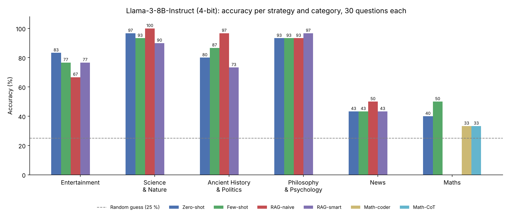

<div align="center">

# PoliMillionaire

Open-weight LLMs playing *Who Wants to Be a Millionaire?*<br>
Prompting, retrieval from Wikipedia, tool use for maths and a speech interface, all run locally.




</div>

<br>

| | |
|---|---|
| Context | Four-person project, Natural Language Processing course, Politecnico di Milano (spring 2026) |
| Model | Llama-3-8B-Instruct, 4-bit NF4 quantisation, on a Colab T4 GPU |
| Techniques | Zero-shot and few-shot prompting, RAG on Wikipedia, self-consistency voting, model-written Python for maths, per-category routing, Whisper transcription |
| Key finding | 80 to 100 % accuracy on knowledge categories; recent news and maths remain hard (40 to 50 %) |

---

## Contents

- [The task](#the-task)
- [Approach](#approach)
- [Results](#results)
- [Decoding sweep](#decoding-sweep)
- [Getting started](#getting-started)
- [Repository structure](#repository-structure)
- [Limitations](#limitations)

---

## The task

Each game asks up to 15 multiple-choice questions (4 options) of increasing difficulty in one of six categories: Entertainment, Ancient History & Politics, Science & Nature, Maths, Philosophy & Psychology and News. A game ends at the first wrong answer.

The course imposed three rules:

| Rule | Consequence |
|---|---|
| Open-weight models, run locally | No LLM API; the model must fit on a free Colab GPU |
| 30 seconds per question | Generation runs in a thread with a 22-second limit |
| External knowledge must be raw documents | Retrieval from the Wikipedia search API, never from another LLM |

## Approach

```
question + 4 options
        │
        ▼
 ┌─────────────── router (per category) ───────────────┐
 │ zero-shot │ few-shot │ RAG │ majority vote │ maths   │
 └─────┬─────────────────┬──────────────────────┬──────┘
       │                 │                      │
       │        Wikipedia search API     LLM writes Python, the notebook
       │        → page text (≤ 1,200 ch)  runs it, closest option wins
       ▼                 ▼                      ▼
   Llama-3-8B-Instruct (NF4 4-bit), generation thread with a 22 s limit
        │
        ▼
 answer extraction (cascade of regular expressions) → option index 0 to 3
```

| Strategy | Idea |
|---|---|
| Zero-shot | Question and options only: the model's own knowledge |
| Few-shot | Two worked examples in the prompt |
| RAG-naive | Wikipedia search on the first five words of the question; the page text is added to the prompt |
| RAG-smart | The model first writes a search query, then answers with the retrieved text |
| Majority vote | Three sampled answers (temperature 0.7); the most frequent wins |
| Math-coder | For numeric questions the model writes Python, the notebook runs it and maps the result to the closest option; conceptual questions fall back to chain-of-thought |
| Math-CoT | Step-by-step reasoning before the final answer |

Benchmark calls retry transient network errors with exponential backoff and skip a question instead of aborting the run.

## Results

Each strategy was evaluated on 30 single-question games per category (Section 8 of the notebook). Accuracies, in %, are recomputed from the per-question logs saved in the notebook; random guessing gives 25 %.

| Category | Zero-shot | Few-shot | RAG-naive | RAG-smart | Other |
|---|---:|---:|---:|---:|---|
| Entertainment | 83.3 | 76.7 | 66.7 | 76.7 | Majority vote 60.0 |
| Science & Nature | 96.7 | 93.3 | 100.0 | 90.0 | |
| Ancient History & Politics | 80.0 | 86.7 | 96.7 | 73.3 | |
| Philosophy & Psychology | 93.3 | 93.3 | 93.3 | 96.7 | |
| News | 43.3 | 43.3 | 50.0 | 43.3 | |
| Maths | 40.0 | 50.0 | n/a | n/a | Math-coder 33.3, Math-CoT 33.3 |

### Takeaways

1. An 8B model already handles knowledge questions: 80 to 100 % on Science, History, Philosophy and Entertainment without retrieval.
2. Simple retrieval helps where facts are specific. RAG-naive is best on History (+16.7 points over zero-shot) and Science; letting the model write its own query (RAG-smart) does not help on average.
3. News is the hard category (about 45 %). Questions refer to articles from the weeks before the game, after the model's training data, and Wikipedia barely helps, most likely because these events are too recent to be covered.
4. Maths remains weak. Few-shot reaches 50 %, while code execution and chain-of-thought stay at 33 % in this run and are much slower (about 11 s and 25 s per question, against about 1 s).
5. With 30 questions per cell, differences of one or two answers (3 to 7 points) are within noise.

### Speech interface

The game also has an audio mode: questions are transcribed with Whisper and passed to the same strategies.

| Whisper model | Average transcription time | Fits the 30 s budget |
|---|---:|---|
| base | 0.45 s | yes |
| small | 7.3 s | yes |
| medium | 19.8 s | barely |

On 20 spoken questions, the three models' transcriptions agree at 92 to 93 % (string similarity between models, without manual ground truth). Times are averaged over 5 questions.

## Decoding sweep

[`experiments/decoding_sweep/`](experiments/decoding_sweep/) holds a resumable sweep over 126 decoding configurations of Mistral-7B-Instruct-v0.2 (temperature 0 to 2, top-p 0.1 to 1, 1 to 3 beams) with a few-shot prompt. Each configuration plays 5 full games in each of the 6 categories; the score is the number of questions answered before the first mistake.

| | |
|---|---|
| Mean progress | 23 % of the 15 levels |
| Best configuration | 37 % (temperature 0.7, top-p 0.8, 3 beams) |
| Strongest category | Philosophy & Psychology, 50 % |
| Weakest categories | Maths 4 %, News 7 % |

The 18 greedy configurations (temperature 0, where top-p has no effect) repeat the same decoding setting, yet their scores range from 17 % to 32 %, a spread as large as across all 126 configurations. The effect of the decoding parameters cannot be separated from the run-to-run noise of the game, so the best configuration should not be over-interpreted.

## Getting started

The notebook targets Google Colab with a GPU (a T4 is enough for the 4-bit model).

1. Open [`notebooks/PoliMillionaire.ipynb`](notebooks/PoliMillionaire.ipynb) in Colab (File, Open notebook, GitHub tab, `bilal-jaiel/polimillionaire-llm`) and run the installation cell.
2. The game client (`millionaire_client`) and server were provided by the course and are not included; the notebook imports the client from Google Drive.
3. Store the game server URL and credentials in Colab *Secrets* as `MILLIONAIRE_API_URL`, `MILLIONAIRE_USER` and `MILLIONAIRE_PASS`. They are never written in the notebook.
4. Run the sections in order: model loading, utilities, strategies, then the benchmarks (60 to 90 minutes on a T4 for every category).

For the sweep, set the same three variables with `os.environ[...]` and follow the instructions at the top of `sweep.py`; `plot_sweep.py` reads `sweep_results.csv` locally.

## Repository structure

```
├── notebooks/
│   └── PoliMillionaire.ipynb        models, strategies, benchmarks, speech interface
├── experiments/
│   └── decoding_sweep/
│       ├── sweep.py                 resumable sweep, run on Colab
│       ├── sweep_results.csv        126 configurations × per-category scores
│       └── plot_sweep.py            analysis plots
├── docs/
│   └── accuracy_by_category.png
└── requirements.txt
```

## Limitations

- Small samples: 30 questions per strategy and category, one run each, so confidence intervals are wide (about ±16 points around 70 %).
- Saved summary cells: in the notebook, the plotting and summary cells of Section 9 were run in a session whose results did not match the logs of Section 8 (the History and Philosophy columns repeat News), and Section 12 quotes an earlier run. Both are flagged in the notebook; the table above is recomputed from the logs.
- Code execution is not sandboxed: model-generated Python runs in the notebook's interpreter, with only a separate namespace and a time limit. It should run in an isolated process or container.
- The router was configured from an earlier benchmark run and does not match the best strategies of the final run.
- The benchmarks depend on the course's game server and client, so they can only be re-run while that server is reachable.

---

<div align="center">
<sub>Alexis Schneider · Arnaud Grassian · Kalaivaasan Balakumar · Bilâl Jaiel<br>
<a href="https://github.com/bilal-jaiel">GitHub</a> · <a href="https://www.linkedin.com/in/bilal-jaiel/">LinkedIn</a></sub>
</div>
